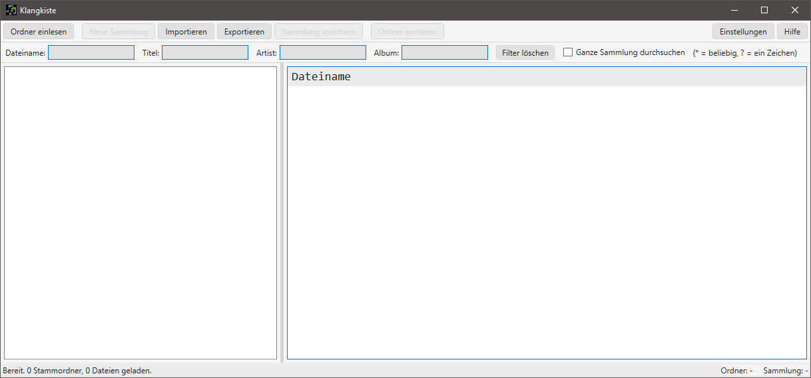
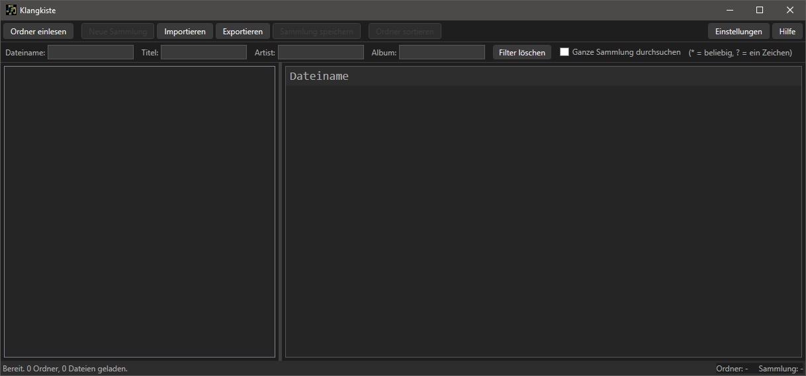
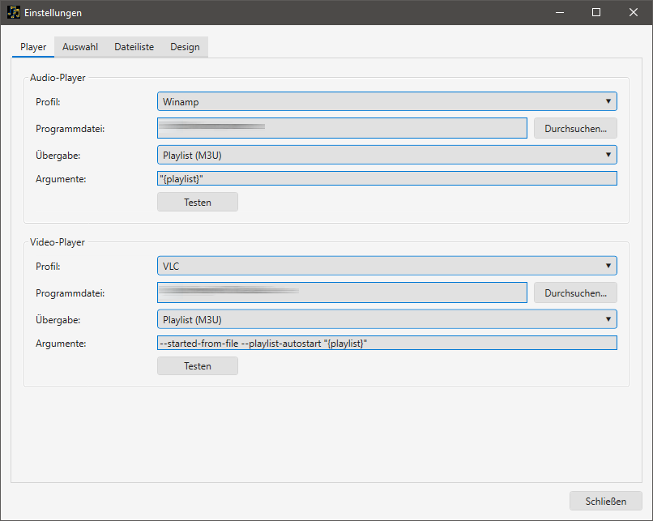
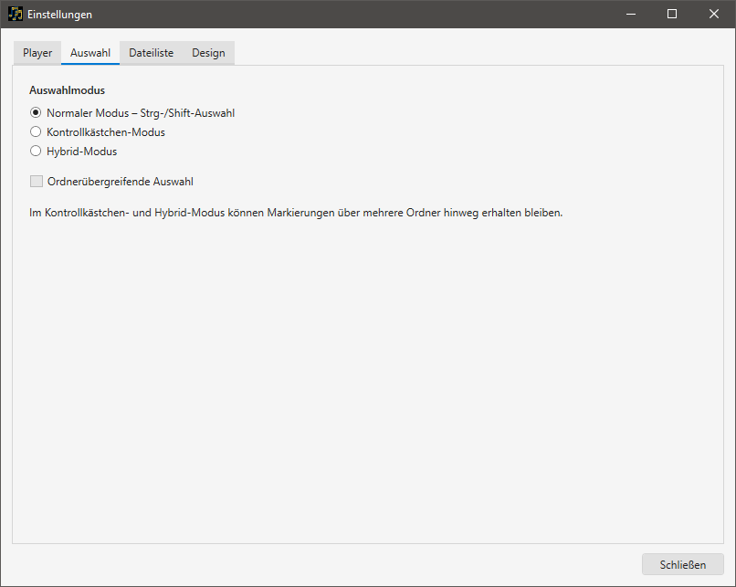
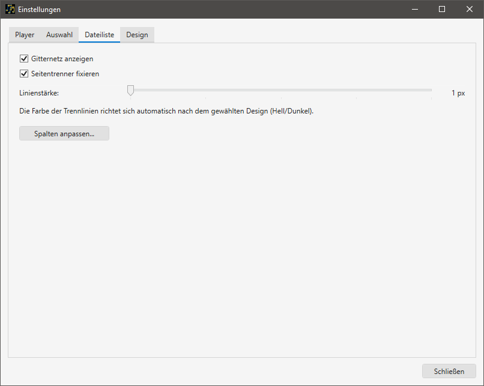
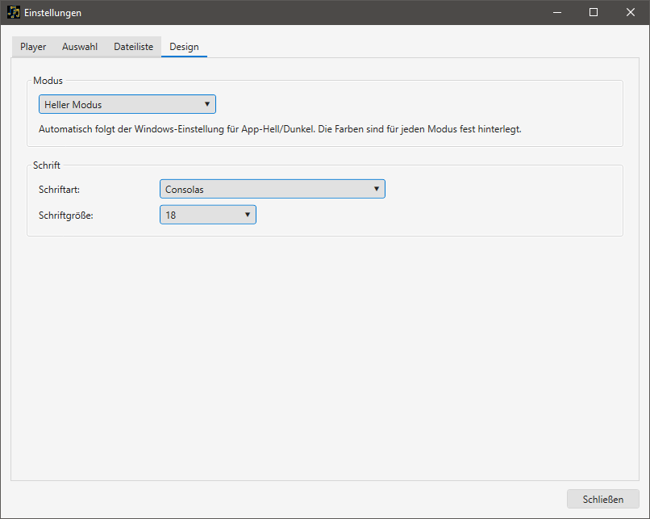

# Klangkiste

Eine kleine Alternative zur bekannten MPEG Audio Collection, allerdings mit ein paar Erweiterungen.

* An English version -or rather, a translation- is currently being worked on.

## Vorschau

## Welche Erweiterungen sind hinzugekommen?

* Ganz einfach: Es gibt jetzt die Möglichkeit seinen Wunsch-Player selbst zu wählen, oder den Standard über die Windowsverknüpfung zu belassen.
* Frei wählbare Formate zum Einlesen oder Überspringen (Filtern). Audio- und Videodateien können getrennt voneinander Eingelesen werden oder zusammen.
* Nahezu alle Dateiformate werden unterstützt zum Einlesen. Für Dateien die keine Audio- oder Videodateien sind wird die Standard Windowsverknüpfung verwendet. (Muss vor dem Einlesen eingestellt werden!)
* Dazu einen wählbaren Modus für das Aussehen: (Automatisch mit Windowseinstellungen, Heller Modus und Dunkler Modus).
* Obendrein die Möglichkeiten des Auswahlverfahrens, wie man seine Dateien auswählen möchte. (Siehe Bilder)
* Es wurde darauf geachtet das Programm schlicht und übersichtlich zu halten, damit es sparsam mit den Resourcen umgeht.

## Systemvoraussetzungen

* Voraussetzung ist ab Windows 7 (Zumindest sollte es auch darauf laufen). In dem angebotenen Release ist .NET 10.0 schon enthalten. Es muss also nicht nachinstalliert werden.

## Lizenz

Dieses Projekt steht unter der **MIT-Lizenz** – Details findest du in der Datei [LICENSE.txt](LICENSE.txt).
